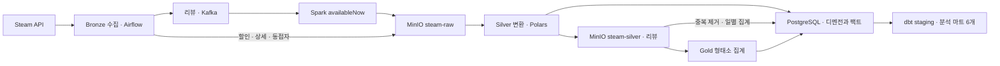

# Steam 게임 데이터 파이프라인

Steam의 할인·리뷰·동시 접속자·게임 상세 데이터를 수집해 할인 이력과 리뷰 작성 수·플레이타임·동접자 추이를 분석하는 개인 프로젝트다. Airflow로 수집·변환을 관리하고 로컬 Docker의 Kafka·Spark·MinIO·PostgreSQL 및 dbt로 Bronze → Silver → Gold/Mart를 구성했다.

할인/비할인 비교는 관측 데이터 분석이며 무작위 대조 실험이나 인과 추정은 아니다. 현재 저장소에는 파이프라인 코드와 검증 자료를 포함하며 대표 결과 화면은 첨부하지 않았다.

## 개발 기간과 버전

아래는 Git 이력 기준 기간이다. 실제 투입 시간과 개인 기여 범위는 별도 확인 대상이다.

- **초기 개발: 2026-02~04.** API Hook·Operator, 컨트롤 테이블, 큐·청크 저장, 게임별 병렬화, Silver 테이블과 dbt 마트 구현.
- **후속 개선: 2026-07~09.** 테스트 환경, DB 복제 구성, Kafka·Spark 경로와 API 파라미터 점검. Terraform과 Snowflake Hook 코드도 추가했다.
- **현재 보완: 2026-10.** 날짜 구간 기반 과거/증분 수집, 체크포인트 재개, Kafka 전송 확인, 리뷰 중복 제거와 사후 검증.

날짜 수집 구현은 `1c2fa66`, 격리된 서비스 통합 테스트는 `29ab342`에 포함된다. 2026-10-16 실제 Steam 소량 테스트와 DB 비교 실험은 별도로 추가·기록했다. 과거 운영 로그의 성공을 현재 버전의 전체 파이프라인 실행 결과로 취급하지 않는다.

## 현재 데이터 처리 구조



- **수집 대상:** 할인 목록으로 `tracked_games`를 갱신하고 활성 플래그로 수집 대상을 제어한다. 리뷰 기본 언어는 한국어·영어다. 할인 목록은 KR 기준 조건으로 최대 400개를 요청한다.
- **리뷰 Bronze:** `SteamReviewsToKafkaOperator` → Kafka `steam-reviews` → `SparkReviewsKafkaToS3Operator` → `steam-raw/reviews/{실행시각}/{appid}_chunk_{batch_id}.parquet`. Spark는 `availableNow`로 실행 시점까지 쌓인 메시지를 처리하고 종료한다.
- **날짜 수집:** 2000-01-01 UTC부터 최초 실행 종료 시각까지 30일 구간을 과거 방향으로 순회한다. 5만 건마다 날짜 경계를 이동하고 1초를 겹친다. 과거 수집 완료 후 하루를 겹쳐 증분 수집한다. 언어별 상태는 `tracked_games.review_cursors` JSONB v3에 저장하며 Kafka 전송 성공을 확인한 뒤 갱신한다.
- **Silver:** author 필드와 UTC 작성/수정 시각을 정규화해 `steam-silver/reviews/appid=.../language=.../year=.../month=.../`에 저장한다. 원본 키 해시를 파일명에 포함해 실행이 다른 원본 청크의 덮어쓰기를 피한다. 현재 리뷰 DAG는 Bronze `reviews/` 전체를 조회한다.
- **DB·Gold:** 게임·장르, 가격 이력, 동접자 스냅샷, 리뷰 일별 건수와 플레이타임을 PostgreSQL에 적재한다. 형태소 빈도와 dbt의 게임 개요·할인·리뷰·동접자·플레이타임 마트로 연결한다.

리뷰 식별 키는 `(appid, recommendationid)`다. 후속 일별 집계와 형태소 분석은 앱의 여러 파일을 합쳐 최신 `timestamp_updated`, 다음으로 최신 `_collected_at`을 선택한다. Bronze에는 경계·재시도 중복을 보존한다. 언어는 `koreana → korean`으로 정규화하며 날짜 집계는 UTC 작성 시각 기준이다.

대표 행 단위는 `dim_games`의 게임 1개, `fact_review_daily`와 `fact_review_playtime_daily`의 `(app_id, language, review_date)`다. `collected_through`는 수집 워터마크, `reviews_collected_at`은 체크포인트 기록 작업 시각이다.

[리뷰 DAG](dags/bronze_api_extract_review.py) · [날짜 수집기](plugins/utils/review_collection.py) · [중복 제거](plugins/utils/review_dedup.py) · [dbt 마트](dbt/steam_dbt/models/marts/)

현재 리뷰 동작의 기준 문서는 [체크포인트 설계와 검증](docs/review_checkpoints.md)이다. 기존 [전체 파이프라인 설명](PIPELINE.md)에는 cursor와 입력 prefix의 과거 설명이 일부 남아 있다.

## 디렉터리

```text
docker-compose-local.yml   로컬 서비스·볼륨·네트워크
airflow/                   JDK를 포함한 Airflow 이미지
dags/                      Bronze·Silver·Gold DAG
plugins/hooks/             외부 서비스 연계 Hook
plugins/operators/         수집·변환·집계 Operator
plugins/utils/             날짜 체크포인트·리뷰 중복 제거
init-db/                   최초 DB 스키마
init-db-replication/       PostgreSQL 복제 초기화
dbt/steam_dbt/             staging 뷰·마트 SQL
tests/offline/             고정 입력·외부 I/O 대체 검증
tests/integration/         실제 서비스·선택적 Steam API 검증
scripts/                   DB 호출 방식 비교
docs/                      검증 조건·측정 원본·로드맵
terraform/                 클라우드 인프라 코드
logs/                      로컬 로그·JUnit 결과 (Git 제외)
```

## 실행 환경과 설정

2026-10-16 기존 Docker 환경에서 Python **3.10.13**, Airflow **2.8.1**, Polars **1.43.2**, PySpark **4.2.0**, kafka-python **3.0.11**, pytest **9.1.1**, PostgreSQL **15.15**로 아래 검증을 실행했다. DB 실험은 psycopg2-binary **2.9.9**를 사용했다. Airflow 이미지는 JDK 17을 설치한다.

Docker Desktop의 Linux 컨테이너와 Docker Compose가 필요하다. Spark worker 2개는 각각 메모리 2GB를 요청하므로 나머지 서비스를 위한 추가 여유가 필요하다. 일부 이미지와 추가 Python 패키지는 버전 미고정이며 재빌드 시 환경이 달라질 수 있다. Spark/PySpark/Scala와 [Kafka connector 좌표](plugins/operators/spark_reviews_kafka_to_s3.py)의 호환성을 확인한다.

### 환경변수와 Airflow 설정

루트에 `.env`를 직접 만든다. 현재 `.env.example`은 없다. 실제 키·비밀번호는 Git에 넣지 않는다.

```dotenv
STEAM_API_KEY=<Steam API key>
SLACK_WEBHOOK_URL=
REPLICATOR_PASSWORD=<local replication password>
```

Snowflake 사용 시에만 `SNOWFLAKE_USER`, `SNOWFLAKE_PASSWORD`, `SNOWFLAKE_ACCOUNT`, `SNOWFLAKE_DATABASE`, `SNOWFLAKE_SCHEMA`, `SNOWFLAKE_WAREHOUSE`, `SNOWFLAKE_ROLE`을 설정한다. Compose에 참조가 있어 미설정 경고가 날 수 있지만 로컬 리뷰 검증에는 필요하지 않다. Slack URL을 비우면 외부 알림을 보내지 않는다.

Airflow UI의 Admin에서 아래 항목을 확인한다.

- **Variable `steam_api_key`:** 현재 Hook은 `Variable.get("steam_api_key")`를 읽는다. `.env`의 `STEAM_API_KEY`만으로는 등록되지 않는다. 실제 리뷰 조회 자체에는 키가 필요 없지만 할인 목록 수집에는 필요하다.
- **Connection `analytics_db`:** Postgres, host `analytics-postgres`, port `5432`, database `steam_analytics`. 계정은 Compose의 분석 DB 설정과 맞춘다.
- **Connection `minio_s3`:** Amazon Web Services, 계정은 Compose의 MinIO 설정, Extra는 `{"endpoint_url":"http://minio:9000"}`.
- **Connection `kafka_default`:** host `kafka`, port `9092`. Compose의 `AIRFLOW_CONN_KAFKA_DEFAULT`로 제공된다.
- **Connection `spark_default`:** host `spark-master`, port `7077`. Compose의 `AIRFLOW_CONN_SPARK_DEFAULT`로 제공된다.

현재 Compose의 MinIO·분석 DB 변수명은 `AIRFLOW__CONN__...` 형태로, 자동 Connection 형식인 `AIRFLOW_CONN_...`과 다르다. 기존 환경에서 테스트가 통과했더라도 신규 환경에서는 UI에 두 연결을 등록해야 한다.

## 처음 실행하는 순서

아래는 Compose와 코드 기준 신규 설치 안내다. 이번 검증은 기존 볼륨·연결 설정이 있는 환경에서 수행했으며 깨끗한 환경의 전체 설치·전체 DAG 연속 실행을 새로 검증하지 않았다. dbt DAG의 네트워크명이 `steam-project_default`로 고정되어 있어 Compose 프로젝트명을 `steam-project`로 지정한다.

### 1. 이미지·DB·버킷 준비

```sh
docker compose -p steam-project -f docker-compose-local.yml build airflow-scheduler
docker compose -p steam-project -f docker-compose-local.yml --profile dbt build dbt
docker compose -p steam-project -f docker-compose-local.yml up -d airflow-postgres analytics-postgres minio kafka spark-master spark-worker-1 spark-worker-2
docker compose -p steam-project -f docker-compose-local.yml run --rm minio-init
docker compose -p steam-project -f docker-compose-local.yml run --rm airflow-init
docker compose -p steam-project -f docker-compose-local.yml up -d airflow-webserver airflow-scheduler
docker compose -p steam-project -f docker-compose-local.yml ps
```

DB 초기 SQL은 분석 DB 볼륨을 처음 생성할 때 적용된다. `minio-init`은 `steam-raw`, `steam-silver`, `steam-processed` 버킷을 만든다. Airflow 초기화 후 위 Variable·Connection을 등록하고 서비스 health와 DAG import 오류를 확인한다. 복제 실습은 별도로 `analytics-postgres-replica`를 시작하고 [failover 절차](DB_FAILOVER_RUNBOOK.txt)를 따른다.

- Airflow: <http://localhost:8080>, 계정은 Compose의 `airflow-init` 설정 참조
- MinIO 콘솔: <http://localhost:9001>, S3 API: <http://localhost:9000>
- 분석 DB: host `localhost`, port `5434`, database `steam_analytics`

Gold의 DockerOperator는 `steam-dbt:latest` 이미지, scheduler의 Docker socket 접근 권한, 위 네트워크가 필요하다. DB 계정 변경 시 `dbt/steam_dbt/profiles.yml`도 맞춘다.

### 2. 작은 검증부터 실행

전체 수집 DAG를 켜기 전에 아래 오프라인 → 서비스 통합 → 선택적 실제 Steam 테스트를 실행한다. 통합 테스트는 임시 appid·전용 Kafka 토픽·S3 prefix·Spark checkpoint를 사용하고 종료 시 테스트 자원을 정리한다. 실제 Steam 테스트는 저장 없이 Hook과 날짜 수집기를 검증한다.

### 3. 전체 파이프라인 수동 실행

DAG는 처음 생성할 때 pause 상태다. 선행 작업의 **성공과 출력 존재를 확인한 뒤** 다음 순서로 진행한다. 처음에는 리뷰 DAG의 `app_ids`·`languages`를 한 게임·한 언어로 제한한다. continuous 모드는 해당 게임이 DB의 활성 리뷰 수집 대상으로 등록되어 있어야 한다.

1. `steam_bronze_01_discount_game_extract`: 할인 목록 → `tracked_games` 등록. 이후 수집은 이 테이블의 활성 플래그를 따른다.
2. `steam_bronze_04_app_details_extract`, `steam_bronze_03_player_count_extract`, `steam_bronze_02_review_extract`: 상세·동접자·리뷰 Bronze 생성. 리뷰 DAG 내부는 API→Kafka 다음 Spark→S3 순서다.
3. `steam_silver_01_dim_games`, `steam_silver_02_fact_price`, `steam_silver_04_fact_players`, `steam_silver_03_fact_reviews`: 각 Bronze 입력 정제·적재.
4. `steam_silver_05_review_daily`, `steam_silver_06_review_playtime`: Silver 리뷰 전체에서 중복 제거 후 일별 집계.
5. `steam_gold_01_review_morphemes`: 언어별 형태소 집계.
6. `steam_gold_02_dbt_marts`: DAG 내부의 `dbt_staging` → `dbt_marts` 순서로 분석 마트 생성.

일일 스케줄은 대체로 Bronze 08~09 UTC, Silver 09~10 UTC, Gold 11~12 UTC다. 동접자는 08/14 UTC, 해당 Silver는 09/15 UTC다. 한국시간은 UTC+9이며 정확한 스케줄은 `dags/`를 참조한다. **다른 DAG 사이에는 완료를 기다리는 의존성이 없어 시각 배치만으로 위 순서가 보장되지 않는다.** 리뷰를 제외한 일부 Silver는 logical date의 일자 prefix를 읽으므로 수동 실행 시 대응하는 Bronze 날짜와 맞춰야 한다.

### 4. 결과 확인과 종료

- MinIO `steam-raw/reviews/`: 실행별 청크, `steam-silver/reviews/`: 게임·언어·연월 파티션
- `tracked_games.review_cursors`: 언어별 backfill/incremental 상태와 `collected_through`
- `dim_games`, `fact_price_history`, `fact_concurrent_players`, `fact_review_daily`, `fact_review_playtime_daily`: 대상 게임·날짜 결과
- `gold_review_morphemes`, `mart_*`: 후속 집계·마트

```sql
SELECT appid, review_cursors, reviews_collected_at
FROM tracked_games WHERE appid = 730;

SELECT app_id, language, review_date, review_count
FROM fact_review_daily WHERE app_id = 730
ORDER BY review_date DESC, language LIMIT 20;
```

```sh
docker compose -p steam-project -f docker-compose-local.yml down
```

일반 종료는 컨테이너·네트워크를 종료하고 named volume은 유지한다. `down -v`는 DB·MinIO·Kafka·Spark checkpoint 볼륨을 삭제하는 초기화이므로 일반 종료에 사용하지 않는다.

## 테스트 실행과 검증 결과

아래는 **2026-10-16 현재 코드 사후 검증** 결과다. 대상 버전·입력·기대값·환경·미검증 범위는 [검증 기록](docs/review_checkpoints.md)에 있다. 컨테이너에 루트 `pytest.ini`가 마운트되지 않아 `PYTHONPATH`를 명시하며 미등록 integration marker 경고가 날 수 있다.

### 오프라인: 40 passed

고정 입력으로 날짜 구간 전환·경계 중첩·재개, Kafka 전송 실패 처리, ID 중복 제거와 집계를 검증한다. 외부 I/O를 대체하고 실제 프로젝트 로직을 실행한다.

```sh
docker exec airflow-scheduler env PYTHONPATH=/opt/airflow/plugins python -m pytest --confcutdir=/opt/airflow/tests/offline /opt/airflow/tests/offline -q --junitxml=/opt/airflow/logs/review_offline_20261016.xml
```

### 실제 로컬 서비스: 각 1 passed, 합계 2 passed / 0 skipped

첫 테스트는 Kafka·Postgres의 중단 커서 재개와 증분 워터마크 갱신을 확인한다. 두 번째는 Kafka→Spark→MinIO로 리뷰 2건을 배치당 1건씩 보내 청크 2개의 행·ID·appid·언어를 확인한다. Steam 응답은 고정 데이터로 대체하고 두 번째 테스트의 Slack 요약도 대체한다.

```sh
docker exec airflow-scheduler env PYTHONPATH=/opt/airflow/plugins python -m pytest /opt/airflow/tests/integration/operators/test_review_checkpoint_resume_integration.py -m integration -v -rs --junitxml=/opt/airflow/logs/review_checkpoint_integration_20261016.xml
docker exec airflow-scheduler env PYTHONPATH=/opt/airflow/plugins python -m pytest /opt/airflow/tests/integration/operators/test_reviews_kafka_to_s3_integration.py -m integration -v -rs --junitxml=/opt/airflow/logs/review_kafka_spark_s3_integration_20261016.xml
```

### 실제 Steam 소량 조회: 1 passed / 0 skipped

CS2 영어 리뷰, `recent`, `purchase_type=all`로 2026-10-15 12:00~12:10 UTC에서 3건/고유 ID 3개를 관측했다. 날짜 범위·정렬·중복·완료 상태를 확인했다. 3건은 이번 관측값이며 재실행 시 바뀔 수 있다. 아래 환경변수를 지정하지 않으면 이 테스트는 skip한다.

```sh
docker exec airflow-scheduler env PYTHONPATH=/opt/airflow/plugins RUN_STEAM_LIVE_TEST=1 python -m pytest /opt/airflow/tests/integration/operators/test_review_steam_live_integration.py -m integration -v -s -rs -o junit_family=legacy --junitxml=/opt/airflow/logs/review_steam_live_20261016.xml
```

JUnit XML은 호스트 `logs/`에 저장되고 Git에는 포함되지 않는다. 저장소에는 요약과 실행 코드를 보관한다. 전체 `pytest`에는 별도 서비스·입력 조건의 기존 테스트와 API 호출 스크립트도 있으므로 위 명령으로 범위를 지정한다. CI는 현재 [Ruff 코드 검사](.github/workflows/)만 수행하며 pytest 자동화는 연결하지 않았다.

## 새 DB 비교 실험

2026-10-16 실제 PostgreSQL 연결에서 고정 집계 10,000행을 **각 방식 5회** 측정했다. 단일 트랜잭션으로 신규 행을 넣고 순서를 바꿔 반복했으며, 매번 전체 결과가 입력과 일치하는지 검증했다. 중앙값은 다음과 같다.

- 행별 `cursor.execute`: **1.920549초**, 약 **5,207 rows/s**
- 현재 운영 코드의 호출 방식인 `cursor.executemany`: **1.927902초**, 약 **5,187 rows/s**
- `execute_values`, 1,000행씩 묶음: **0.253402초**, 약 **39,463 rows/s**

이 조건에서 executemany와 행별 execute는 유사했고 execute_values는 행별 방식 대비 약 7.58배 처리량을 보였다. **execute_values는 실험한 개선 후보이며 운영 코드에는 적용하지 않았다.**

타이머는 재사용 연결의 SQL 호출·직렬화·마지막 commit을 포함하며 입력 생성·테이블 준비·검증은 제외한다. TEMP 테이블이므로 영구 테이블의 데이터 WAL·복제·디스크 내구성 비용을 반영하지 않는다. 기존 행 충돌 UPDATE나 전체 ETL 시간, 과거 `210초→18초`를 재현한 결과가 아니다.

```sh
docker exec airflow-scheduler env PYTHONPATH=/opt/airflow/plugins python /opt/airflow/scripts/profile_review_db_writes.py --rows 10000 --repeats 5 --output /opt/airflow/logs/review_db_write_profile_20261016.json
```

[실험 코드](scripts/profile_review_db_writes.py) · [15개 표본·환경·입력/코드 해시](docs/evidence/review_db_write_profile_20261016.json) · [과거 수치 점검과 새 실험 조건](docs/performance_evidence.md)

## 알려진 한계와 후속 과제

- **수집 완전성:** 실제 10만 건 초과 수집, 독립적인 정답 ID와의 비교, `200만+ 전량 적재`는 이번 검증으로 입증하지 않았다. 하루 중첩보다 늦게 나타난 오래된 리뷰와 오래된 리뷰의 수정·삭제를 포괄하는 reconciliation은 없다.
- **전송·재시작:** Kafka ACK는 S3 적재 완료가 아니다. 발행 후 DB 저장 전 중단 시 재발행 중복이 가능하며 정확히 한 번 전송은 보장하지 않는다. 컨테이너 강제 종료, 일부 청크 저장 후 Spark checkpoint 복구, broker 장애·보관 기간 검증은 남아 있다. Kafka는 단일 브로커다.
- **처리 규모:** Spark foreachBatch는 제한된 배치를 driver의 `collect()`로 모아 업로드한다. Silver는 Bronze 전체, 일별 집계와 Gold는 앱별 전체 리뷰를 재조회한다. Gold는 언어마다 같은 앱 파일을 다시 읽는다.
- **운영·재현성:** DAG 간 완료 의존성이 없고 일부 이미지·의존성은 미고정이다. DB 복제·수동 failover와 Terraform·Snowflake Hook 코드의 존재를 현재 클라우드 운영·장애 복구 검증 완료로 설명하지 않는다.
- **SQL 의미:** `mart_discount_review_trend.baseline_7d_avg`는 직전 7개 **행** 기준이다. 누락 날짜가 있으면 7일 평균과 다르며 가격 미수집일은 비할인으로 취급한다.
- **로그:** Steam 공통 요청 로그는 파라미터를 출력하며 일부 메서드는 API 키를 포함한다. 키 마스킹은 미적용 상태로, 키를 쓰는 실행의 로그를 공개할 때 비밀 값을 제거해야 한다.
- **과거 성능:** 메모리 약 2GB 관측은 캡처가 없는 개발 경험이다. `2GB→800MB`, `6,140→5,000초`, `210→18초`, `500→5,800 rows/s`의 전후 측정 조건은 미확인으로 보류한다. 새 DB 실험을 과거 성과로 대체하지 않는다.

[검수 로드맵](docs/roadmap.md) · [리뷰 검증 기록](docs/review_checkpoints.md) · [성능 근거 점검](docs/performance_evidence.md)
