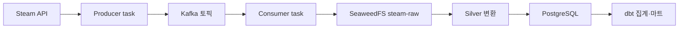

# 파이프라인 재구성 계획

2026-11-18 확정. Silver 레이어부터 다시 구축하고 Bronze는 수집 방식만 재편한다.

## 1. 분류 기준

- **정기 적재:** API가 현재 값만 제공해 놓친 시점을 복구할 수 없는 데이터
- **On-demand:** 과거 값을 다시 조회할 수 있는 데이터. 분석 요청이 있을 때만 수집
- 정기 적재 데이터는 추적 시작 이후만 존재하므로 대상 범위를 넓게 유지

## 2. 데이터별 수집 방식

| 데이터 | API | 방식 | 주기 | 대상 |
|---|---|---|---|---|
| 게임 목록 | `IStoreService/GetAppList` | 정기 | 매일 | 전체 게임 (DLC·소프트웨어·영상·하드웨어 제외), `if_modified_since` 증분 |
| 가격·할인·리뷰 수 | `IStoreQueryService/Query` | 정기 | 매일 1회 (18:00 UTC 전후) | 전체 게임, 페이지 단위 |
| 동접자 top 100 | `ISteamChartsService/GetGamesByConcurrentPlayers` | 정기 | 1시간 | 호출 1회로 100개 |
| 동접자 관리 목록 | `ISteamUserStats/GetNumberOfCurrentPlayers` | 정기 | 1시간 | `player_watchlist` 활성 게임 |
| 동접자 스캔 | `ISteamUserStats/GetNumberOfCurrentPlayers` | 정기 | 매일 1회 | 스캔 일정이 도래한 게임만 (4절) |
| 게임 메타 | `store/api/appdetails` | 정기 (저빈도) | 신규 등록 시 1회 + 주 1회 | 관리 목록과 분석 요청 게임 |
| 리뷰 상세 | `store/appreviews` 날짜 구간 | On-demand | 요청 시 | 요청한 게임·언어·기간 |
| 리뷰 평가 추이 | `store/appreviewhistogram` | On-demand | 요청 시 | 요청한 게임·언어 |
| 뉴스·패치노트 | `ISteamNews/GetNewsForApp` | On-demand | 요청 시 | 필요 시 추가 |

- 리뷰 요약 일별 적재는 하지 않음. `appreviewhistogram`이 출시 이후 월별과 최근 30일 일별 긍정·부정 수를 제공함을 2026-11-18 CS2로 확인
- `appreviews`, `appreviewhistogram`, `appdetails`는 비공식 엔드포인트라 응답 구조 변경 감시 필요
- `Query`의 가격·리뷰 수 필드와 페이지당 최대 건수는 구현 전 실측 필요

## 3. 처리 구조

- **Kafka 유지:** producer-consumer 구조로 외부 연계를 쉽게 하고 API 대기 작업의 버퍼로 사용
- **Spark 제거:** consumer는 Airflow task에서 토픽을 끝까지 읽고 parquet로 S3 저장소에 저장한 뒤 offset commit
- **S3 저장소:** MinIO 공식 이미지 배포 중단으로 로컬은 SeaweedFS로 교체. Airflow 연결 ID `s3_storage`, 운영은 같은 연결을 AWS S3로 전환
- **전달 보장:** at-least-once. 중복은 Silver에서 키 기준으로 제거
- **토픽:** 데이터 종류별 1개, 메시지 key는 `appid`

| 토픽 | 생산자 |
|---|---|
| `steam.app_list` | 게임 목록 |
| `steam.prices` | 가격·할인·리뷰 수 |
| `steam.players` | top 100과 관리 목록 동접자를 한 토픽으로 병합 |
| `steam.player_scan` | 동접자 스캔 |
| `steam.app_details` | 게임 메타 |
| `steam.reviews` | 리뷰 상세 |
| `steam.review_histogram` | 리뷰 평가 추이 |

- **DAG 연결:** Bronze 완료 시 Airflow Dataset으로 Silver 실행. 시각 배치 의존 제거
- **On-demand DAG:** `schedule=None`, 파라미터 `app_ids`, `languages`, `start_date`, `end_date`. 날짜 구간 체크포인트로 중단 후 재개

## 4. 동접자 관리 목록과 스캔 최적화

목표는 전체 게임을 매일 조회하지 않고 IP 차단 위험 없이 관리 목록을 유지하는 것

### 컨트롤 테이블 `player_watchlist`

| 컬럼 | 용도 |
|---|---|
| `appid` | 게임 ID |
| `source` | `scan` 자동 등록, `manual` 수동 등록, `top100` 순위 진입 |
| `first_top100_at` | top 100 최초 진입 시각. 값이 있으면 고정 수집 대상 |
| `is_active` | 1시간 수집 대상 여부 |
| `last_player_count`, `recent_peak` | 최근 스캔·수집 값 |
| `next_scan_at` | 다음 스캔 예정 시각 |
| `scan_interval_days` | 현재 스캔 간격 |
| `consecutive_low_scans` | 연속 저조 스캔 횟수 |

### 스캔 대상 줄이기

- **간격 차등:** 스캔 결과가 낮을수록 다음 스캔 간격을 늘림 (예: 1일 → 2일 → 4일 … 최대 30일). 다시 오르면 1일로 복귀
- **우선 스캔:** 신규 출시, 최근 할인 시작, `Query` 리뷰 수 급증 게임은 간격과 무관하게 다음 스캔에 포함
- **사전 필터:** 매일 받는 `Query` 리뷰 수를 활동성 신호로 사용. 리뷰가 거의 없는 게임은 긴 간격에서 시작
- **결과:** 매일 스캔 대상은 `next_scan_at`이 도래한 게임만이라 전체 게임 수보다 훨씬 적음

### 관리 목록 선정: 기준값 대신 호출 예산

- 고정 기준값(예: 100명) 대신 시간당 호출 예산 `N`으로 관리 목록 크기를 정함
- 스캔 결과를 최근 피크 기준으로 정렬해 상위 `N`개를 활성화하고 나머지는 비활성
- `manual` 등록 게임은 예산과 별도로 항상 활성

### top 100 경계 게임 처리

- top 100 경계의 게임은 순위에서 갑자기 빠졌다 다시 들어오기도 함. 빠진 동안 수집이 끊기면 시계열에 구멍이 생김
- top 100에 한 번이라도 들어온 게임은 매시 수집 때 `player_watchlist`에 `first_top100_at`과 함께 즉시 등록
- 이 게임은 순위를 벗어나도 계속 수집. 예산 정렬과 저조 스캔으로 자동 비활성하지 않고 수동으로만 해제
- 매시 수집 순서: top 100 호출 → 신규 진입 게임 등록 → 활성 관리 목록 중 이번 top 100 응답에 없는 게임만 개별 호출. 같은 게임 중복 호출 없음
- 동접자 팩트에 값 출처(`top100`, `individual`)를 남겨 두 API 값 차이를 나중에 검증
- `N`과 간격 규칙은 Airflow Variable로 두고 첫 전체 스캔 분포를 보고 조정

### 요청률 제어

- 모든 동접자 호출이 공유하는 token bucket. 기본 초당 5건 (2026-11-18 측정 무오류 상한 초당 40건의 1/8)
- 429 수신 시 `Retry-After`만큼 대기 후 요청률 절반으로 감소, 연속 429 시 해당 실행 중단과 알림
- 최초 전체 스캔은 여러 날에 나눠 실행

## 5. Silver 원칙

- **스냅샷 팩트 (동접자·가격):** append-only, 키 `(app_id, collected_at)`. 수집 실패는 0이 아닌 NULL
- **리뷰:** `(appid, recommendationid)`당 최신본 1행 upsert. 요청 단위 처리, Bronze 전체 재스캔 없음
- **역할:** Silver는 정제·중복 제거·타입 통일까지. 일별 리뷰 수·플레이타임 등 집계는 dbt로 이동
- **시각:** 모두 UTC 저장

### 동접자 저장 구조

관리 게임 N개 × 수집 시각 M개만큼 증가. 3,000개 매시 기준 연 약 2,600만 행으로 추정

| 레이어 | 위치 | 단위 | 정렬 | 용도 |
|---|---|---|---|---|
| Bronze | `steam-raw/players/dt=YYYY-MM-DD/hour=HH/` | 매시 1파일, 그 시각 전체 게임 | 없음 | 원본 보관·재처리 |
| Silver | `steam-silver/players/month=YYYY-MM/` | 월 1파일, 매일 재작성 | `app_id`, `collected_at` | 전체 시계열 보관본 |
| DB | `fact_concurrent_players` | 1시간 1행, 전체 기간 | 월별 파티션 | 분석 조회 |
| dbt | 동접자 일별 집계 | 하루 1행 | - | 장기 추이·마트 |

- 게임별 파일은 만들지 않음. S3 객체는 append 불가이고 작은 파일이 대량 발생
- DB 인덱스 `(app_id, collected_at)`. 1시간 단위 원본을 기간 제한 없이 보관
- parquet은 조회 경로가 아닌 보관본. DB 재구축과 외부 내보내기에 사용
- 정렬된 parquet은 row group의 `app_id` min/max 통계로 게임별 부분 읽기 가능
- 용량 문제 발생 시 오래된 월 파티션을 분리하고 parquet 직접 조회 또는 on-demand 복원 DAG 추가

## 6. 제거 대상

- 형태소 파이프라인: `dags/gold_morphemes_DAG.py`, `plugins/operators/gold_reviews_to_morphemes.py`, `init-db/04_create_gold_morphemes.sql`, 관련 의존성
- Spark: `plugins/operators/spark_reviews_kafka_to_s3.py`, `plugins/hooks/spark_hook.py`, Compose의 Spark 서비스, Airflow 이미지 JDK, 관련 통합 테스트
- 매일 리뷰 수집 DAG: on-demand DAG로 대체
- `silver_review_daily`, `silver_review_playtime`: dbt 모델로 대체

## 7. 작업 순서

각 단계 완료 시 커밋

1. 형태소·Spark 제거, MinIO → SeaweedFS 교체 (2026-11-19 완료, 컨테이너 실행 검증 전)
2. Kafka consumer task (토픽 → S3 parquet)
3. 게임 목록·가격 정기 수집 (`Query` 실측 포함)
4. 동접자 top 100·관리 목록·스캔과 `player_watchlist`
5. On-demand 리뷰·평가 추이 DAG
6. Silver 스키마 (`init-db`)와 operator, 테스트
7. dbt staging·마트 재작성
8. README·PIPELINE 갱신
